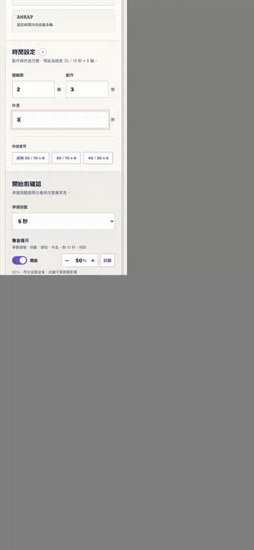
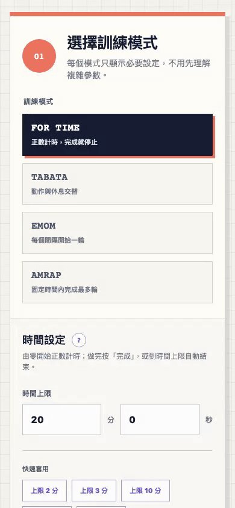

# BOX CLOCK 使用說明

以手機瀏覽器開啟 <https://box-clock.jlab-app.cloud>，三個步驟就能開始訓練。下方動畫以手機尺寸錄製，白色圓圈是點擊的位置。

## 1. 選模式、設時間

1. 在「選擇訓練模式」點一個模式：FOR TIME、TABATA、EMOM 或 AMRAP。
2. 不確定怎麼設，點「時間設定」旁的「?」看範例。
3. 點「快速套用」的常用組合，或直接修改數字。
4. 往下確認「開始前確認」的摘要；準備倒數、聲音開關與音量也在這裡調整，按「試聽」可以先聽鐘聲。

所有設定都會記在這支手機的瀏覽器，下次開啟沿用。

## 2. 開始、暫停與重置

1. 按「開始訓練」進入計時畫面，此時還不會計時。
2. 按「開始」：先跑準備倒數，接著依模式自動切換動作與休息，並以鐘聲提示。
3. 中途按「暫停」，再按「繼續」接著計時。
4. 「重置」回到這次訓練的起點；「結束並返回」回到設定頁。

計時中切換 App 或鎖定螢幕會自動暫停並保存進度，回來後按「繼續」即可。計時中右上角顯示現在時間；螢幕常亮無法啟用時會跳出提醒。

## 3. 完成並分享成績

1. FOR TIME 做完按「完成」；其他模式時間到會自動停在結果畫面。
2. 按「分享」，輸入剛做的運動，按「馬上分享！」。
3. 在預覽中選擇「複製文字」、「下載浮水印」（透明背景圖片），或用手機內建的分享選單傳出去。

## 加到主畫面

安裝後像 App 一樣從主畫面開啟，沒有網路也能使用。

- **iPhone（Safari）**：點分享按鈕 →「加入主畫面」。
- **Android（Chrome）**：點頁首的「安裝 APP」，或瀏覽器選單 →「安裝應用程式」。
